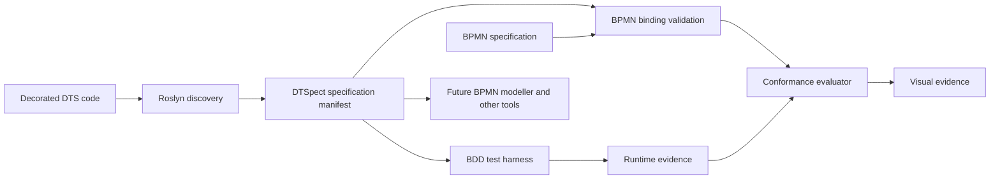

# DTSpect

**Model it. Specify it. Prove it.**

A proposed open-source, code-first workflow specification, behaviour-driven
testing, and process-conformance framework for **Microsoft Durable Task
Scheduler (DTS)**.

**Swagger/OpenAPI meets SpecFlow/Reqnroll and BPMN, built for durable
orchestrations.**

> **Design stage:** this repository contains the product specification,
> architectural proposals, community guidance, and documentation CI. There is
> no runnable DTSpect framework, package, manifest generator, or modeller yet.
> All APIs and integration mechanisms below are proposed and unvalidated.

## Start with the contract

DTSpect aims to connect code-first orchestration with business intent and
execution evidence. Its central product is the **DTSpect specification
manifest**: a versioned, machine-readable contract that other tools can consume,
in the spirit of an OpenAPI document. This does not imply OpenAPI compatibility.

The manifest would describe orchestration identities, semantic step mappings,
BPMN associations, and version fingerprints. A modeller, test runner, or
conformance evaluator could consume that shared contract without each
re-discovering the application. DTS remains the execution runtime.

The [authoritative specification](DTSpect.md) incorporates the latest
contract-first direction and supersedes the original BPMN-first brief.

## Proposed capabilities

| Area | Intended capability, not yet implemented |
| --- | --- |
| C# annotations | `[DtspectOrchestration]` identifies processes and model associations; `[DtspectStep]` associates activities with stable semantic IDs. Both complement native DTS attributes. |
| Discovery | Roslyn-based build-time discovery, potentially incremental generation, produces a versioned specification manifest. |
| Mapping validation | Detect missing, ambiguous, duplicate, stale, and inconsistent mappings, with progressively stricter policies. |
| Living BPMN specification | BPMN 2.0 describes permitted behaviour; a future modeller consumes discovered metadata and supports explicit bindings. |
| BDD tests | Gherkin and Reqnroll-inspired .NET bindings exercise real orchestration logic with controlled dependencies. |
| Conformance and evidence | Compare observed behaviour with scenario assertions and model constraints; later show instance paths, failures, waits, and retries where evidence permits. |

Attributes alone do not describe complete control flow. Unmapped implementation
details are not automatically violations. Runtime history, tags, and
OpenTelemetry are evidence sources to investigate, not established DTSpect
integrations. Missing evidence or version mismatches must not produce a
misleading pass.

## Architecture and first milestone



This is a proposed flow, not an implemented system. The initial priority is
**annotations → generated manifest → binding validation**, followed by a BDD
vertical slice and a small visual report. A full BPMN editor comes later.

The design keeps orchestration versions, model versions/fingerprints, and the
generated manifest fingerprint distinct. Repeated activity invocations,
replay, retries, and concurrency require explicit correlation semantics.
See [ADR 0001](docs/adr/0001-annotation-manifest-contract.md) and the
[milestone gates](docs/ROADMAP.md).

## Repository guide

| Path | Purpose |
| --- | --- |
| [DTSpect.md](DTSpect.md) | Authoritative proposed product specification. |
| [docs/adr/](docs/adr/) | Architectural proposals and open decisions. |
| [docs/ROADMAP.md](docs/ROADMAP.md) | Ordered milestones and acceptance evidence. |
| [CONTRIBUTING.md](CONTRIBUTING.md) | How to discuss changes, validate docs, and submit a PR. |
| [CODE_OF_CONDUCT.md](CODE_OF_CONDUCT.md) | Community expectations and reporting limitations. |
| [scripts/check_docs.py](scripts/check_docs.py) | Dependency-free documentation checks. |
| [.github/workflows/docs.yml](.github/workflows/docs.yml) | CI for content that actually exists. |

There are deliberately no placeholder application projects or SDK packages.
The .NET hosting model, test runner, published schema, and UI stack will be
selected through implementation evidence and ADRs.

## Local validation

With Git and Python 3.11 or later installed, run from the repository root:

```sh
python scripts/check_docs.py
git diff --check
```

The checker verifies text hygiene, relative Markdown file/directory links, and
JSON syntax in fenced examples. It does not validate link fragments, external
URLs, C# examples, BPMN semantics, or a manifest schema. CI is documentation
validation only; it is not proof of DTSpect runtime behaviour.

Contributions to the contract design and small, testable discovery experiments
are welcome. Start with [CONTRIBUTING.md](CONTRIBUTING.md).

## License

Copyright 2026 Re-David-1992. Licensed under the
[Apache License, Version 2.0](LICENSE). The license includes an express patent
grant; see the [official license terms](https://www.apache.org/licenses/LICENSE-2.0).
